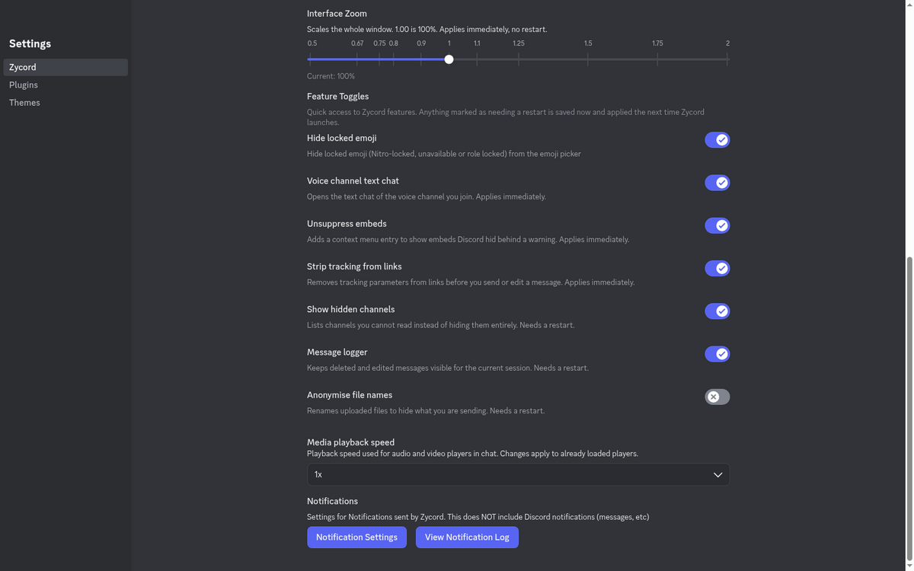
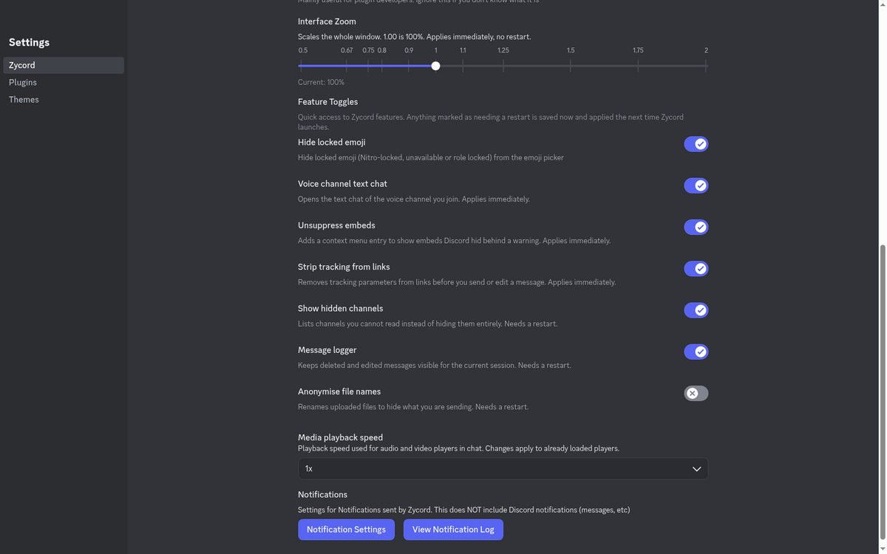

<p align="center">
  <a href="https://izynu.github.io/Zycord-Client/">
    
  </a>
</p>

<p align="center">
  <strong>A Discord client for Windows with 173 plugins, built on top of the web client you already know.</strong>
</p>

<p align="center">
  <a href="https://github.com/izynu/Zycord-Client/releases/latest/download/Zycord-Client-Setup-1.0.0-x64.exe">
    
  </a>
</p>

<p align="center">
  <sub>Version 1.0.0 &nbsp;|&nbsp; 97.7 MB &nbsp;|&nbsp; Windows 10 and 11, x64 &nbsp;|&nbsp; Free and open source</sub>
</p>

<p align="center">
  <a href="https://github.com/izynu/Zycord-Client/releases"></a>
  <a href="LICENSE"></a>
  <a href="https://izynu.github.io/Zycord-Client/"></a>
</p>

<p align="center">
  <a href="#install">Install</a> &nbsp;|&nbsp;
  <a href="#what-it-does">Features</a> &nbsp;|&nbsp;
  <a href="#every-plugin">All 173 plugins</a> &nbsp;|&nbsp;
  <a href="#build-from-source">Build</a> &nbsp;|&nbsp;
  <a href="#what-it-is-not">Disclaimer</a>
</p>


## What it is

Zycord Client is a desktop application for Windows. It opens Discord's web client in its own window and adds a plugin layer on top: 173 plugins, a theme engine, interface zoom from 50 to 200 percent, a settings panel, and a tray icon.

It installs to its own directory and runs as a separate program. The official Discord application is never modified, and both can be installed side by side.



---

## Install

| Step | Action |
| --- | --- |
| 1 | Download the installer using the button at the top of this page. |
| 2 | Run `Zycord-Client-Setup-1.0.0-x64.exe` and choose an install location. |
| 3 | Launch Zycord from the Start menu or the desktop shortcut. |

The build is unsigned. Windows SmartScreen will show a warning the first time. Choose **More info**, then **Run anyway**.

<p align="center">
  <a href="https://github.com/izynu/Zycord-Client/releases/latest/download/Zycord-Client-Setup-1.0.0-x64.exe">
    
  </a>
</p>

---

## What it does

| Feature | Detail |
| --- | --- |
| **Plugin system** | 173 plugins included, 87 of them on by default. Each has its own settings page. |
| **Interface zoom** | Scales the whole window from 50 to 200 percent. Found under Settings, Zycord. Applies instantly. |
| **Feature Toggles** | One panel with seven switches for the most used plugins, plus a playback speed selector. |
| **System tray** | Lives in the notification area. Closing the window hides it to the tray instead of quitting. |
| **Screen sharing** | Full display and window capture, wired through the shell so Discord's picker works. |
| **Voice channel chat** | Opens the text chat for the voice channel you join, without leaving the call. |
| **Message logging** | Keeps deleted and edited messages visible for the session. |
| **Role and permission viewers** | Shows the roles and permissions behind a member or a channel. |
| **Profile theming** | Custom profile colours on your own profile, plus role colours everywhere. |
| **Analytics blocking** | Discord's analytics and crash reporting are blocked before the first request. |
| **Theme engine** | Loads CSS themes, with a QuickCSS editor for live changes. |
| **Window memory** | Restores size and position on launch, clamped to the current display. |

<p align="center">
  
</p>

<p align="center"><sub>The zoom slider and feature toggles, both in Settings, Zycord.</sub></p>

---

## Every plugin

All 173 plugins are listed with their descriptions and default state on the website.

<p align="center">
  <a href="https://izynu.github.io/Zycord-Client/features/">
    
  </a>
</p>

Highlights include hidden channel listing, role and permission viewers, message logging, fake Nitro emoji and stickers, client themes, member counts, silent typing, and Spotify controls.

---

## Build from source

Requires Node.js 22 or newer and pnpm 10 or newer.

```sh
pnpm install   # install dependencies
pnpm build     # build the renderer bundles and the Electron shell
pnpm start     # run the client from source
pnpm dist      # produce the Windows installer in release/
```

`pnpm dist` cross-compiles with electron-builder. Building on Linux requires Wine on your `PATH`.

---

## What it is not

| | |
| --- | --- |
| **Not a patch of the official app** | The official Discord installation is never modified. Both can run side by side. |
| **Not affiliated with Discord** | No endorsement, support, or partnership exists. |
| **Not guaranteed to stay allowed** | Using a modified client may violate Discord's Terms of Service. Use at your own risk. |

---

## Licence

GPL-3.0-or-later. The full text is in [LICENSE](LICENSE). Attribution and modification notices are in [NOTICE](NOTICE).


<p align="center">
  <strong>Zycord Client</strong> by Zynu
</p>

<p align="center">
  <a href="https://izynu.github.io/Zycord-Client/">Website</a> &nbsp;|&nbsp;
  <a href="https://github.com/izynu/Zycord-Client">Repository</a> &nbsp;|&nbsp;
  <a href="https://github.com/izynu/Zycord-Client/releases">Releases</a> &nbsp;|&nbsp;
  <a href="https://zynu.me">zynu.me</a>
</p>
